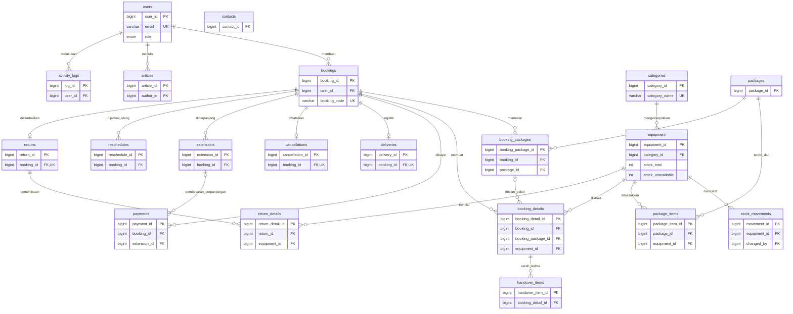

# ERD CampGo (mengikuti SQL kelompok, 20 tabel)

Diagram Mermaid di bawah menampilkan hubungan utama antartabel. Kolom PK/FK dan detail tipe data tetap mengacu pada `database/campgo_db.sql` sebagai sumber utama.

**Catatan:** `contacts` berdiri sendiri. Foreign key petugas pada tabel operasi (`processed_by`, `checked_by`, `received_by`, dan sebagainya) mengarah ke `users`, tetapi tidak digambar seluruhnya agar diagram tetap terbaca. Kardinalitas mengacu pada kombinasi FK dan UNIQUE di SQL; relasi paket booking bersifat opsional.
